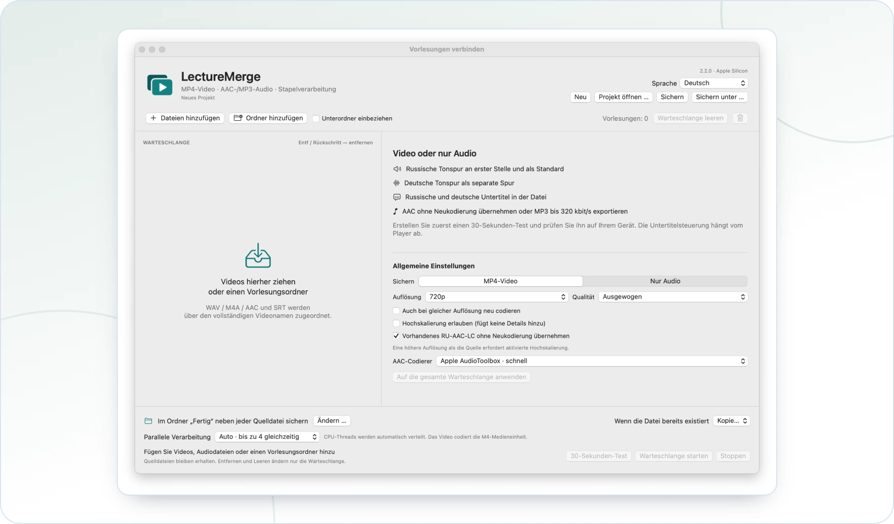

<!-- ppk-readme:head:start -->
<a href="https://popovantondev.github.io/LectureMerge/index.html"><picture><source media="(prefers-color-scheme: dark)" srcset="https://raw.githubusercontent.com/popovantondev/LectureMerge/main/docs/readme/header-de-dark.c4dc9243.svg"></picture></a>
<!-- ppk-readme:head:end -->

# LectureMerge

[Русский](README.ru.md) · **Deutsch** · [English](README.en.md)

<!-- ppk-readme:body:start -->
<p>
<a href="https://github.com/popovantondev/LectureMerge/releases/tag/v2.2.0"><picture><source media="(prefers-color-scheme: dark)" srcset="https://raw.githubusercontent.com/popovantondev/LectureMerge/main/docs/readme/btn-download-de-dark.18a849aa.svg"></picture></a>
<a href="https://popovantondev.github.io/LectureMerge/index.html"><picture><source media="(prefers-color-scheme: dark)" srcset="https://raw.githubusercontent.com/popovantondev/LectureMerge/main/docs/readme/btn-website-de-dark.b390217d.svg"></picture></a>
<a href="https://popovantondev.github.io/LectureMerge/Guide-de.html"><picture><source media="(prefers-color-scheme: dark)" srcset="https://raw.githubusercontent.com/popovantondev/LectureMerge/main/docs/readme/btn-guide-de-dark.91a049f6.svg"></picture></a>
<a href="https://github.com/popovantondev/LectureMerge/issues/new/choose"><picture><source media="(prefers-color-scheme: dark)" srcset="https://raw.githubusercontent.com/popovantondev/LectureMerge/main/docs/readme/btn-bug-de-dark.9914833a.svg"></picture></a>
</p>

<p><a href="https://raw.githubusercontent.com/popovantondev/LectureMerge/main/docs/de/screenshots/main.png"><picture><source media="(prefers-color-scheme: dark)" srcset="https://raw.githubusercontent.com/popovantondev/LectureMerge/main/docs/readme/preview-de-dark.6829dffb.webp"></picture></a><br>
<sub><a href="https://raw.githubusercontent.com/popovantondev/LectureMerge/main/docs/de/screenshots/main.png">Ganzer Screenshot</a></sub></p>

<picture><source media="(prefers-color-scheme: dark)" srcset="https://raw.githubusercontent.com/popovantondev/LectureMerge/main/docs/readme/divider-dark.fbb5c3a2.svg"></picture>
<!-- ppk-readme:body:end -->

<!-- public-release:start -->
Verbindet Vorlesungsvideo, Sprachausgabe, Originalton und Untertitel als MP4; exportiert auch Audio.

**macOS 14+ · Apple Silicon · Release 2.2.0**

**[Herunterladen](https://github.com/popovantondev/LectureMerge/releases/tag/v2.2.0)** · **[Anleitung](https://popovantondev.github.io/LectureMerge/Guide-de.html)** · **[Fehler melden](https://github.com/popovantondev/LectureMerge/issues/new/choose)**

**Voraussetzungen und Grenzen:** Lokale Verarbeitung ohne externen Dienst. Ad-hoc signiert, keine Apple-Notarisierung.

**Erste Schritte:** App-Archiv entpacken, Video, Audio und Untertitel hinzufügen. Vor dem vollständigen Export einen 30-Sekunden-Ausschnitt prüfen.

**App-Dateien:**

- [`LectureMerge-v2.2.0-macos-arm64.zip`](https://github.com/popovantondev/LectureMerge/releases/download/v2.2.0/LectureMerge-v2.2.0-macos-arm64.zip)

**Prüfsummen:** [`SHA256SUMS`](https://github.com/popovantondev/LectureMerge/releases/download/v2.2.0/SHA256SUMS)
<!-- public-release:end -->

LectureMerge führt Vorlesungsvideo, russische Vertonung, Originalton und Untertitel in einer MP4-Datei zusammen. Außerdem kann die App Audio als AAC oder MP3 exportieren. Sie arbeitet lokal auf Ihrem Mac und benötigt weder eine Internetverbindung noch eine Online-API.

## Funktionen

- Die Oberfläche lässt sich zwischen Russisch, Deutsch und Englisch umschalten. Die Wahl bleibt für spätere Starts gespeichert.
- MP4-Dateien mit H.264-Video, AAC-Audio und umschaltbaren russischen und deutschen Untertiteln erstellen.
- Kompatible AAC-LC-Vertonung ohne Neukodierung übernehmen.
- Den deutschen Originalton als eigene Spur behalten.
- Von 144p bis 4K skalieren, die Originalgröße beibehalten oder kompatibles H.264 ohne Neukodierung kopieren.
- Audio als AAC oder MP3 exportieren, einschließlich AAC-Kopiermodus und MP3 bis 320 kbit/s.
- Bis zu vier Warteschlangeneinträge gleichzeitig verarbeiten, Projekte speichern und vor dem vollständigen Export einen 30-Sekunden-Test erstellen.

## Herunterladen

Version 2.2.0 finden Sie auf der [GitHub-Releases-Seite](https://github.com/popovantondev/LectureMerge/releases/tag/v2.2.0). Die Release-Pakete enthalten die App, das Quellarchiv, das Manifest, Prüfsummen und Hinweise zu Drittanbieter-Software.

Die App unterstützt Apple-Silicon-Macs mit macOS 14 oder neuer. Sie ist ad-hoc signiert und nicht von Apple notarisiert. Beginnen Sie mit dem Handbuch in Ihrer Oberflächensprache: [English](docs/en/README.md) · [Deutsch](docs/de/README.md) · [Русский](docs/ru/README.md).

## Dokumentation

- Handbücher mit Screenshot in der jeweiligen Oberflächensprache: [English](docs/en/README.md), [Deutsch](docs/de/README.md), [Русский](docs/ru/README.md)
- Build und Tests: [EN](docs/en/BUILD.md) · [DE](docs/de/BUILD.md) · [RU](docs/ru/BUILD.md)
- Architektur: [EN](docs/en/ARCHITECTURE.md) · [DE](docs/de/ARCHITECTURE.md) · [RU](docs/ru/ARCHITECTURE.md)
- Rechte: [EN](docs/en/RIGHTS.md) · [DE](docs/de/RIGHTS.md) · [RU](docs/ru/RIGHTS.md)
- Drittanbieter-Hinweise: [EN](docs/en/THIRD_PARTY_NOTICES.md) · [DE](docs/de/THIRD_PARTY_NOTICES.md) · [RU](docs/ru/THIRD_PARTY_NOTICES.md)
- Änderungsprotokoll: [EN](docs/en/CHANGELOG.md) · [DE](docs/de/CHANGELOG.md) · [RU](docs/ru/CHANGELOG.md)

## Aus dem Quellcode bauen

Auf einem Apple-Silicon-Mac mit installierten Apple Command Line Tools:

```bash
bash Scripts/check.sh
bash Scripts/test.sh
bash Scripts/build.sh --preview
```

Voraussetzungen für den Build und Einzelheiten zur Prüfung stehen im Handbuch in Ihrer Sprache. Die CI prüft auf macOS Projekt-Metadaten und Swift-Typen; die Hardware-Medienkodierung wird lokal geprüft.

## Rechte und Drittanbieter-Software

Der ursprüngliche Quellcode ist ausschließlich zur öffentlichen Ansicht veröffentlicht; es wird keine Open-Source-Lizenz erteilt. Privatpersonen dürfen ein unverändertes Release-Programm herunterladen und für den persönlichen Gebrauch ausführen. Lesen Sie die Hinweise auf [Englisch](docs/en/RIGHTS.md) · [Deutsch](docs/de/RIGHTS.md) · [Russisch](docs/ru/RIGHTS.md) sowie die [Drittanbieter-Hinweise](docs/de/THIRD_PARTY_NOTICES.md). Für gebündelte Komponenten gelten weiterhin deren eigene Lizenzen.

## Rückmeldungen

Fehlerberichte und Vorschläge sind auf Englisch, Deutsch oder Russisch über [GitHub Issues](https://github.com/popovantondev/LectureMerge/issues/new/choose) willkommen. Nennen Sie die App- und macOS-Version und entfernen Sie persönliche Pfade, Vorlesungsdateien und Untertiteltexte aus Meldungen.
