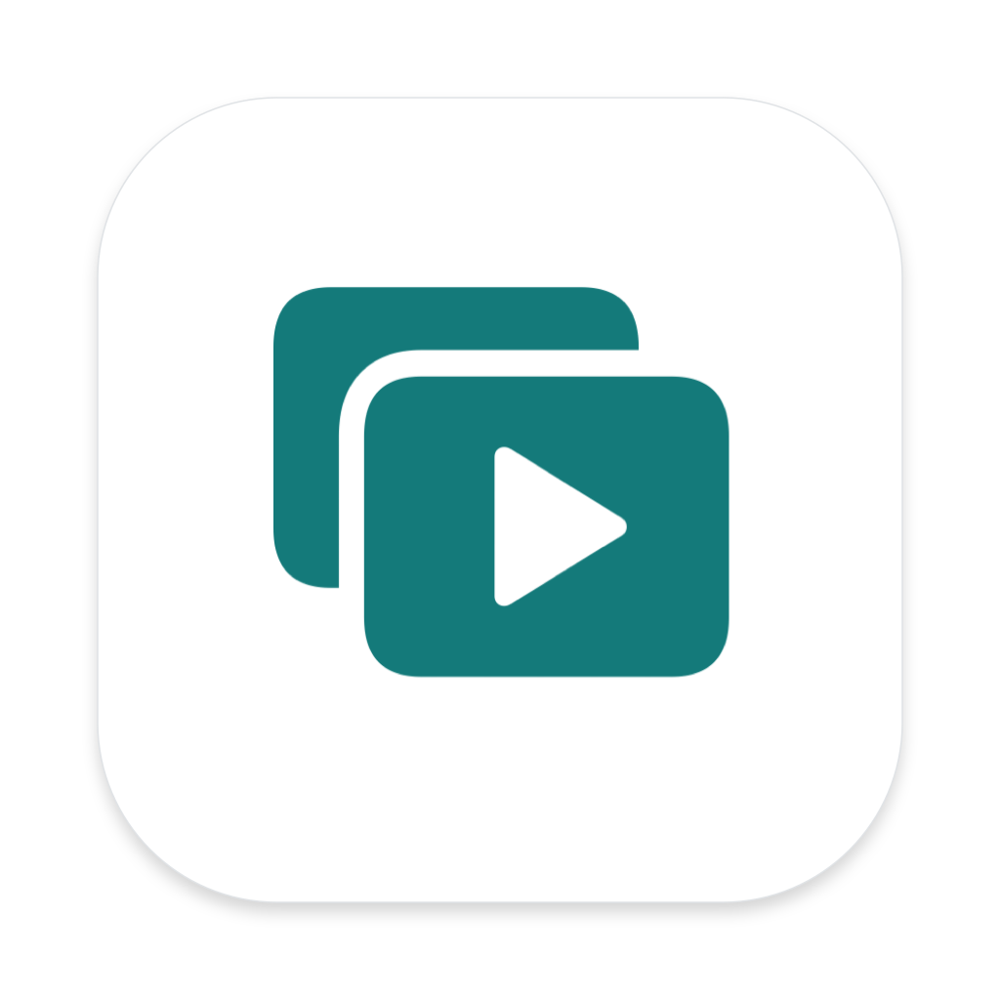
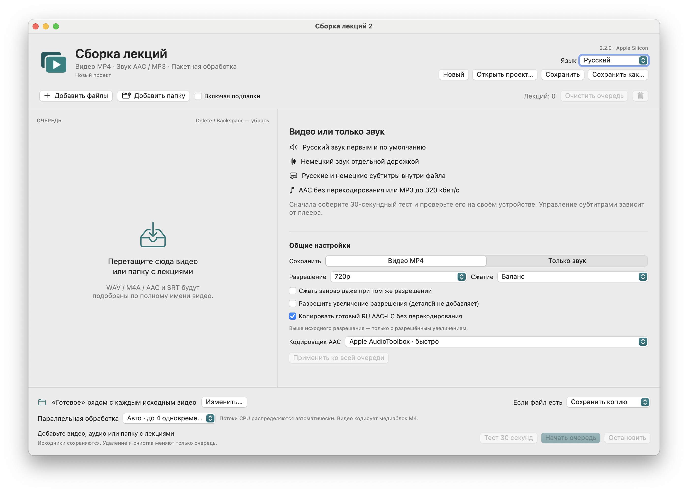

# LectureMerge

<!-- public-release:start -->
Объединяет видео лекции, озвучку, исходное аудио и субтитры в MP4; также экспортирует аудио.

**macOS 14+ · Apple Silicon · Выпуск 2.2.0**

**[Скачать](https://github.com/popovantondev/LectureMerge/releases/tag/v2.2.0)** · **[Инструкция](https://popovantondev.github.io/LectureMerge/Guide-ru.html)** · **[Сообщить об ошибке](https://github.com/popovantondev/LectureMerge/issues/new/choose)**

**Требования и ограничения:** Обработка локальная; внешний сервис не нужен. Приложение подписано ad-hoc и не нотарифицировано Apple.

**Первые шаги:** Распакуйте архив приложения, добавьте видео, аудио и субтитры. Проверьте 30-секундный фрагмент перед полным экспортом.

**Файлы приложения:**

- [`LectureMerge-v2.2.0-macos-arm64.zip`](https://github.com/popovantondev/LectureMerge/releases/download/v2.2.0/LectureMerge-v2.2.0-macos-arm64.zip)

**Контрольные суммы:** [`SHA256SUMS`](https://github.com/popovantondev/LectureMerge/releases/download/v2.2.0/SHA256SUMS)
<!-- public-release:end -->

[Deutsch](README.md) · **Русский** · [English](README.en.md)

[Скачать для macOS](https://github.com/popovantondev/LectureMerge/releases/tag/v2.2.0) · [Русское руководство](docs/ru/README.md) · [Deutsches Handbuch](docs/de/README.md) · [English guide](docs/en/README.md)



**macOS 14 или новее · Apple Silicon · Версия 2.2.0**

LectureMerge объединяет видео лекции, русскую озвучку, оригинальный звук и субтитры в одном MP4-файле. Звук можно также экспортировать как AAC или MP3. Приложение работает локально на вашем Mac и не требует ни интернета, ни онлайн-API.



## Возможности

- Интерфейс переключается между русским, немецким и английским. Выбор сохраняется для следующих запусков.
- Создание MP4 с видео H.264, звуком AAC и переключаемыми русскими и немецкими субтитрами.
- Совместимая озвучка AAC-LC копируется без перекодирования.
- Оригинальный немецкий звук сохраняется отдельной дорожкой.
- Масштабирование от 144p до 4K, сохранение исходного размера или копирование совместимого H.264 без перекодирования.
- Экспорт звука в AAC или MP3, включая режим копирования AAC и MP3 до 320 кбит/с.
- До четырёх элементов очереди обрабатываются одновременно; проекты можно сохранять, а перед полным экспортом — сделать 30-секундный тест.

## Загрузка

Версия 2.2.0 доступна на [странице релизов GitHub](https://github.com/popovantondev/LectureMerge/releases/tag/v2.2.0). В пакеты выпуска входят приложение, архив исходного кода, манифест, контрольные суммы и сведения о стороннем ПО.

Приложение поддерживает компьютеры Mac с Apple Silicon и macOS 14 или новее. Оно подписано ad-hoc и не нотаризовано Apple. Начните с руководства на языке вашего интерфейса: [English](docs/en/README.md) · [Deutsch](docs/de/README.md) · [Русский](docs/ru/README.md).

## Документация

- Руководства со снимком экрана на языке интерфейса: [English](docs/en/README.md), [Deutsch](docs/de/README.md), [Русский](docs/ru/README.md)
- Сборка и тесты: [EN](docs/en/BUILD.md) · [DE](docs/de/BUILD.md) · [RU](docs/ru/BUILD.md)
- Архитектура: [EN](docs/en/ARCHITECTURE.md) · [DE](docs/de/ARCHITECTURE.md) · [RU](docs/ru/ARCHITECTURE.md)
- Права: [EN](docs/en/RIGHTS.md) · [DE](docs/de/RIGHTS.md) · [RU](docs/ru/RIGHTS.md)
- Сведения о стороннем ПО: [EN](docs/en/THIRD_PARTY_NOTICES.md) · [DE](docs/de/THIRD_PARTY_NOTICES.md) · [RU](docs/ru/THIRD_PARTY_NOTICES.md)
- Журнал изменений: [EN](docs/en/CHANGELOG.md) · [DE](docs/de/CHANGELOG.md) · [RU](docs/ru/CHANGELOG.md)

## Сборка из исходного кода

На Mac с Apple Silicon и установленными Apple Command Line Tools:

```bash
bash Scripts/check.sh
bash Scripts/test.sh
bash Scripts/build.sh --preview
```

Требования к сборке и подробности проверки — в руководстве на вашем языке. CI на macOS проверяет метаданные проекта и типы Swift; аппаратное кодирование медиа проверяется локально.

## Права и стороннее ПО

Исходный код опубликован только для просмотра; лицензия открытого ПО не предоставляется. Частные лица могут скачивать и запускать неизменённый бинарный файл выпуска для личного использования. Прочитайте сведения на [английском](docs/en/RIGHTS.md), [немецком](docs/de/RIGHTS.md) и [русском](docs/ru/RIGHTS.md), а также [сведения о стороннем ПО](docs/ru/THIRD_PARTY_NOTICES.md). Для встроенных компонентов продолжают действовать их собственные лицензии.

## Обратная связь

Сообщения об ошибках и предложения принимаются на английском, немецком или русском через [GitHub Issues](https://github.com/popovantondev/LectureMerge/issues/new/choose). Укажите версии приложения и macOS и удалите из сообщений личные пути, файлы лекций и тексты субтитров.
