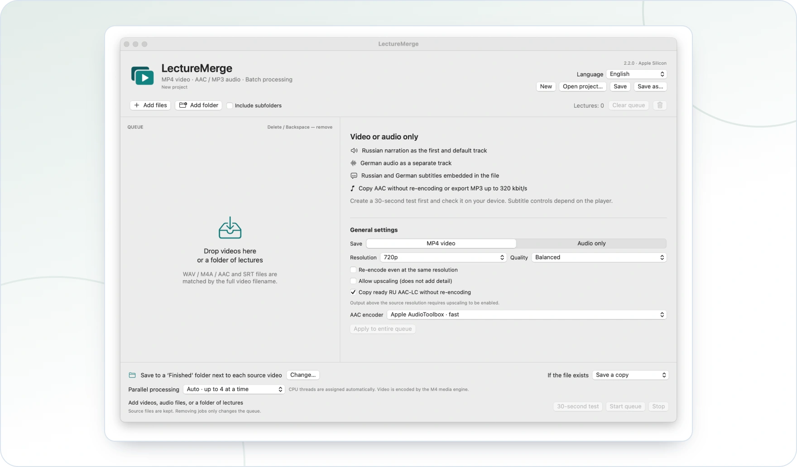

<!-- ppk-readme:head:start -->
<a href="https://popovantondev.github.io/LectureMerge/index-en.html"><picture><source media="(prefers-color-scheme: dark)" srcset="https://raw.githubusercontent.com/popovantondev/LectureMerge/main/docs/readme/header-en-dark.5fab5b88.svg"></picture></a>
<!-- ppk-readme:head:end -->

# LectureMerge user guide

<!-- public-release:start -->
Combine lecture video, narration, original audio and subtitles into MP4, or export audio.

**macOS 14+ · Apple Silicon · Release 2.2.0**

**[Download](https://github.com/popovantondev/LectureMerge/releases/tag/v2.2.0)** · **[User guide](https://popovantondev.github.io/LectureMerge/Guide-en.html)** · **[Report a problem](https://github.com/popovantondev/LectureMerge/issues/new/choose)**

**Requirements and limitations:** Local processing without an external service. Ad-hoc signed and not notarized by Apple.

**First steps:** Extract the app archive and add video, audio and subtitles. Check a 30-second sample before the full export.

**Application files:**

- [`LectureMerge-v2.2.0-macos-arm64.zip`](https://github.com/popovantondev/LectureMerge/releases/download/v2.2.0/LectureMerge-v2.2.0-macos-arm64.zip)

**Checksums:** [`SHA256SUMS`](https://github.com/popovantondev/LectureMerge/releases/download/v2.2.0/SHA256SUMS)
<!-- public-release:end -->

[Download for macOS](https://github.com/popovantondev/LectureMerge/releases/tag/v2.2.0) · [English](README.md) · [Deutsch](../de/README.md) · [Русский](../ru/README.md)

<!-- ppk-readme:body:start -->

<a href="https://github.com/popovantondev/LectureMerge/releases/tag/v2.2.0"><picture><source media="(prefers-color-scheme: dark)" srcset="https://raw.githubusercontent.com/popovantondev/LectureMerge/main/docs/readme/btn-download-en-dark.079d1097.svg"></picture></a>
<a href="https://popovantondev.github.io/LectureMerge/index-en.html"><picture><source media="(prefers-color-scheme: dark)" srcset="https://raw.githubusercontent.com/popovantondev/LectureMerge/main/docs/readme/btn-website-en-dark.b3908e5a.svg"></picture></a>
<a href="https://popovantondev.github.io/LectureMerge/Guide-en.html"><picture><source media="(prefers-color-scheme: dark)" srcset="https://raw.githubusercontent.com/popovantondev/LectureMerge/main/docs/readme/btn-guide-en-dark.93174834.svg"></picture></a>
<a href="https://github.com/popovantondev/LectureMerge/issues/new/choose"><picture><source media="(prefers-color-scheme: dark)" srcset="https://raw.githubusercontent.com/popovantondev/LectureMerge/main/docs/readme/btn-bug-en-dark.2586aa78.svg"></picture></a>

<a href="https://raw.githubusercontent.com/popovantondev/LectureMerge/main/docs/en/screenshots/main.png"><picture><source media="(prefers-color-scheme: dark)" srcset="https://raw.githubusercontent.com/popovantondev/LectureMerge/main/docs/readme/preview-en-dark.b4e317b8.webp"></picture></a> 
<a href="https://raw.githubusercontent.com/popovantondev/LectureMerge/main/docs/en/screenshots/main.png">Full screenshot</a>

<picture><source media="(prefers-color-scheme: dark)" srcset="https://raw.githubusercontent.com/popovantondev/LectureMerge/main/docs/readme/divider-dark.fbb5c3a2.svg"></picture>
<!-- ppk-readme:body:end -->

LectureMerge combines lecture video, Russian narration, original audio, and subtitles in an MP4 file. It can also export one audio track as AAC or MP3. Processing stays on your Mac; no online service is used. **Version 2.2.0 · macOS 14 or later · Apple Silicon.**

[LectureMerge with its English interface](screenshots/main.png)

## Choose the interface language

Use the language selector in the upper-right corner to choose **English**, **Deutsch**, or **Русский**. The choice is saved for the next launch. On first launch, LectureMerge follows the macOS language when it is supported; otherwise it starts in Russian.

## Create an MP4

1. Add a folder of lectures or select video and audio files.
2. Select a queue row and review the matched narration and subtitle files.
3. Choose **MP4 video** and set the resolution, quality, audio, and output options.
4. Choose an output folder, or keep the default folder beside each source video.
5. Run the **30-second test** and check it before processing the full queue.

Compatible RU AAC-LC narration in M4A/MP4 is copied into the output without re-encoding. WAV or incompatible audio is encoded as AAC-LC. If narration ends with the last Russian subtitle, the remaining video is kept and plays without Russian narration; speech is not stretched.

Video presets range from 144p to 4K. **Copy without re-encoding** preserves compatible H.264 exactly. **Original resolution** keeps the frame dimensions and can still re-encode when that option is enabled. Resizing uses Apple's hardware H.264 VideoToolbox encoder.

## Export audio only

Choose **Audio only**, then select Russian narration or an audio track from the source video. AAC copy mode keeps existing AAC data unchanged. Other AAC profiles range from 96 to 256 kbit/s; MP3 ranges from 128 to 320 kbit/s and defaults to 320. M4A preserves timing metadata for later MP4 assembly.

## Queue and projects

Remove a selected row with Delete or Backspace, the trash button, or its context menu. **Clear queue** removes entries from the list only; source files and finished exports remain on disk. Project commands are available in the **Project** menu and the buttons at the top. A project stores paths and settings, not copies of media files.

## Safety and limitations

LectureMerge keeps original files, writes output to a temporary file, then checks it before placing it in the destination. It does not translate or synthesize speech. Subtitle controls depend on the media player. The app is ad-hoc signed and is not notarized by Apple.

## More documentation

- [Build and test instructions](BUILD.md)
- [Architecture overview](ARCHITECTURE.md)
- [Rights and permitted use](RIGHTS.md)
- [Third-party notices](THIRD_PARTY_NOTICES.md)
- [Detailed release verification](../VERIFICATION-2.2.0.md)
